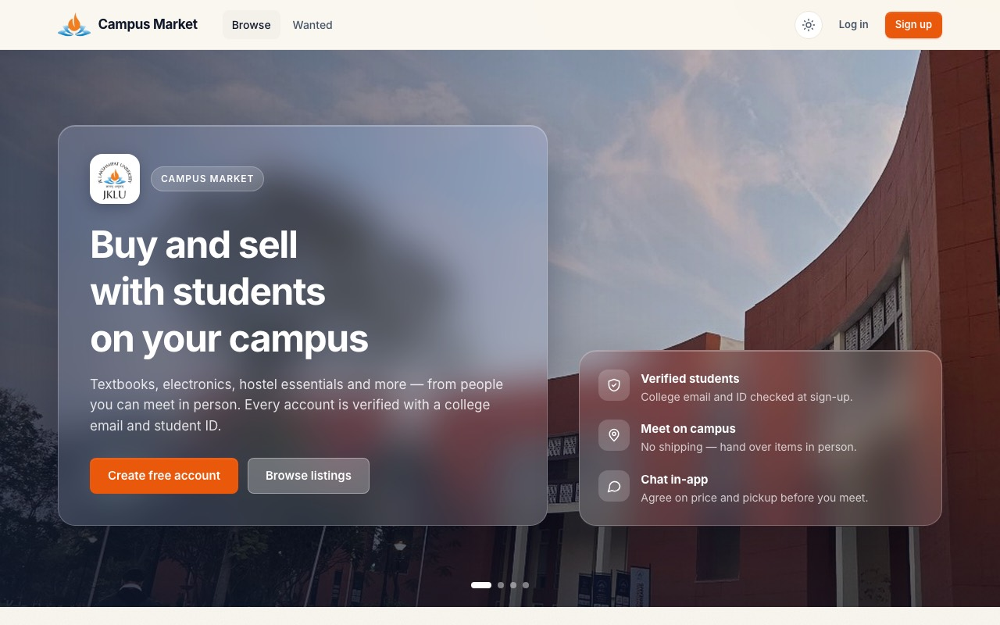
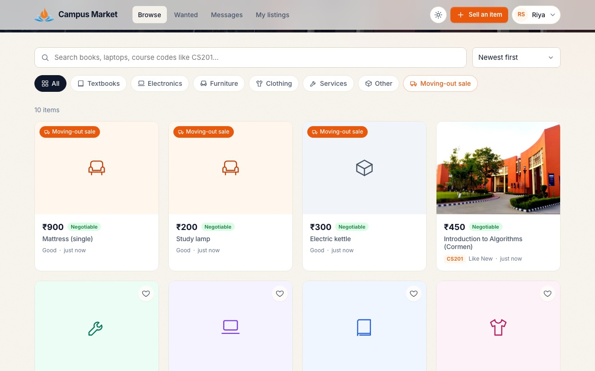
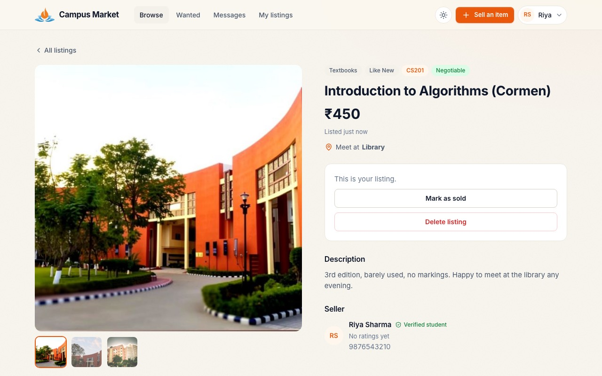
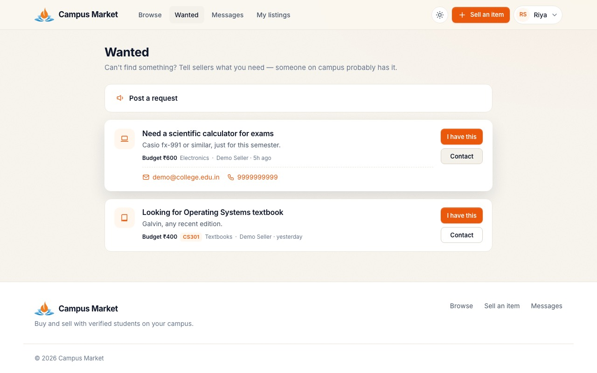
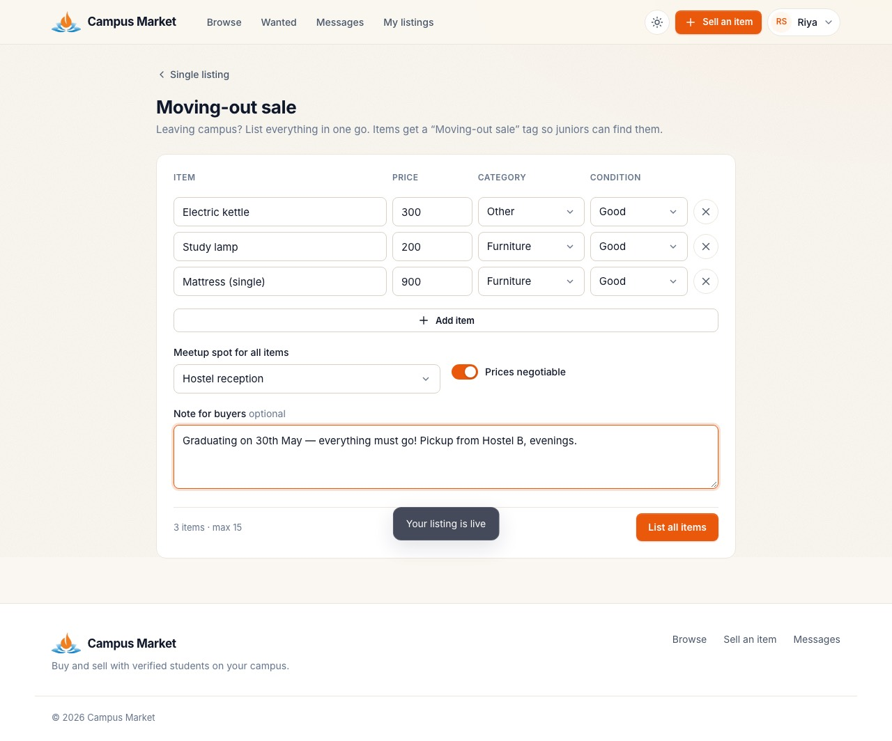
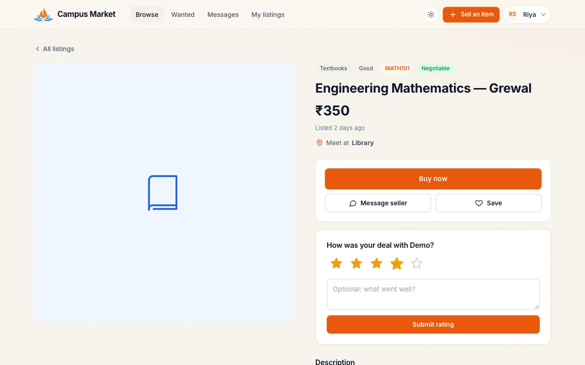
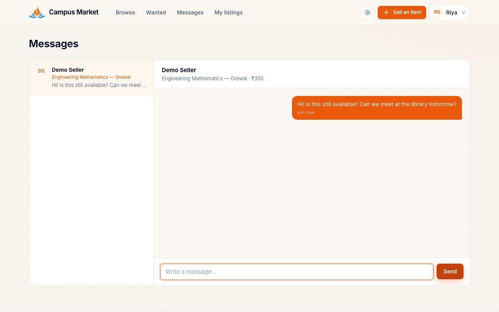
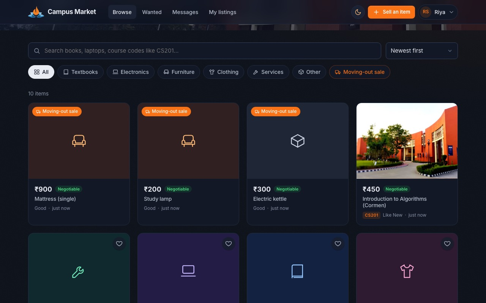

<div align="center">


# Campus Market

**A verified student marketplace — buy, sell and find what you need from people on your own campus.**

No build step · Vanilla JS frontend · Cloudflare Workers + D1 API · Works offline in demo mode

[Features](#-features) · [Quick start](#-quick-start) · [Feature tour](docs/FEATURES.md) · [API](docs/API.md) · [Deploy](docs/DEPLOYMENT.md) · [Architecture](docs/ARCHITECTURE.md)

<br />



</div>

---

## Why Campus Market?

Every semester, students throw away perfectly good textbooks, kettles and mattresses — while juniors buy the same things new. WhatsApp groups are noisy, and you never know who you're dealing with.

Campus Market fixes that:

- **Everyone is a verified student** — college email code + student ID photo at sign-up.
- **Built for campus life** — course-code search for books, safe meetup spots, a "Wanted" board, and a moving-out sale mode for graduating seniors.
- **Trust built in** — seller ratings (only from people who actually dealt with them), reports that auto-hide bad listings, and password-protected accounts.

## ✨ Features

| | |
|---|---|
|  | **Browse & search**<br />Filter by category, sort by price, and search by **course code** (`CS201` finds “cs 201”, “CS-201”…). Save anything with the ♥ button. |
|  | **Rich listings**<br />Up to **4 photos** with a gallery, condition, *Negotiable* tag, course code and a **safe meetup spot** on campus. |
|  | **Wanted board**<br />Post what you're looking for (“Need a cycle for one semester”). Sellers tap **I have this** to list it in one click, or **Contact** you directly. |
|  | **Moving-out sale**<br />Graduating? List up to **15 items at once**. They get a “Moving-out sale” tag and their own filter chip. |
|  | **Seller ratings & reports**<br />Rate a seller once, and only after chatting with or buying from them. Three reports automatically hide a listing. |
|  | **In-app chat with unread badges**<br />A red badge in the header (and the browser tab) tells you when someone replies, so you never miss a deal. |
|  | **Dark mode with an ink-bleed transition**<br />The new theme spreads like ink from wherever you click. Plus a blooming-emblem opening animation, glass UI and smooth page transitions. |

👉 **[Take the full feature tour](docs/FEATURES.md)** — every screen, explained.

## 🚀 Quick start

```bash
git clone https://github.com/shawshank1307/campus-market-v2.git
cd campus-market-v2
python3 -m http.server 5500
```

Open **http://localhost:5500** — that's it.

With no backend running, the app switches to **demo mode**: everything works in your browser (data lives in `localStorage`) and verification codes appear on screen. Sign up with any email like `you@college.edu.in`.

Want the real API locally? See [Run the API locally](docs/DEPLOYMENT.md#run-the-api-locally).

## 🧱 Tech stack

| Layer | Tech |
|---|---|
| Frontend | Plain HTML, CSS and ES modules — no framework, no bundler |
| API | [Hono](https://hono.dev) on **Cloudflare Workers** |
| Database | **Cloudflare D1** (SQLite at the edge) |
| Email | [Resend](https://resend.com) for verification codes |
| Auth | PBKDF2-SHA256 password hashing, session tokens, emailed one-time codes |
| Tests | Node test scripts + Playwright browser test |

## 📁 Project structure

```
├── index.html                 App shell (header, splash animation, footer)
├── css/styles.css             All styles — light/dark themes, glass, motion
├── js/
│   ├── app.js                 Router + every screen
│   ├── api.js                 API client (falls back to demo mode)
│   ├── local-api.js           In-browser demo backend (mirrors the real API)
│   ├── auth.js                Session state
│   ├── password.js            Password hashing + strength rules
│   ├── theme.js               Light/dark theme + ink-bleed transition
│   ├── data.js                Categories, meetup spots, sample data
│   ├── config.js              Site name, photos, production API URL
│   └── image-utils.js         Photo resize/compress before upload
├── cloudflare-backend/
│   ├── src/index.ts           The API (Hono on Workers)
│   ├── schema.sql             Full schema for a fresh database
│   └── migrations/            Upgrades for existing databases
├── tests/                     API, demo-backend and browser tests
├── docs/                      Feature tour, API reference, deployment, architecture
└── assets/jklu/               Campus photos and emblem
```

## 🧪 Tests

```bash
npm test                                   # demo backend — 21 checks, no server needed
node tests/worker.e2e.mjs http://127.0.0.1:8787   # real API — 31 checks (run `wrangler dev` first)
npm install && npm run test:ui             # browser — 20 user journeys (incl. XSS check) + screenshots
```

The browser test needs Chrome (or set `BROWSER=` to any Chromium browser) and the site running on port 5500.

## 📚 Documentation

- **[Feature tour](docs/FEATURES.md)** — a walkthrough of every screen
- **[API reference](docs/API.md)** — every endpoint, request and response
- **[Deployment guide](docs/DEPLOYMENT.md)** — Cloudflare, Resend email, GitHub Pages
- **[Architecture](docs/ARCHITECTURE.md)** — how the pieces fit, data model, security design
- **[Changelog](CHANGELOG.md)** — from JKLU Swap to Campus Market v2

## 🙏 Credits

- Dark-mode ink transition inspired by [Ink Bleed](https://github.com/codemure-official/ink-bleed-theme-changer) by Codemure (MIT), re-implemented with the View Transitions API.
- Campus photos and emblem © JK Lakshmipat University.

## License

[MIT](LICENSE)
