# Case study — From *JKLU Swap* to *Campus Market*

**Redesigning and hardening a student marketplace for JK Lakshmipat University**

| | |
|---|---|
| **Role** | Product design, frontend, backend, security, testing |
| **Timeline** | November 2026 · three iterations |
| **Stack** | Vanilla HTML/CSS/JS · Hono on Cloudflare Workers · Cloudflare D1 · Resend |
| **Outcome** | A professional, trustworthy marketplace with campus-specific features, a hardened auth system and 72 automated checks |

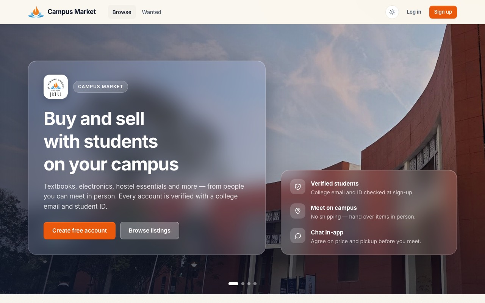

---

## TL;DR

JKLU Swap worked, but it looked like a hobby project and anyone who knew a classmate's roll number could log into their account. Over three iterations it became **Campus Market**: a calm, consistent design in the university's orange; password-protected accounts with codes that are actually emailed; and features built around how students really trade — a *Wanted* board, course-code search, safe meetup spots, seller ratings and a moving-out sale for graduating seniors.

Along the way, browser testing uncovered a **cross-site scripting hole** that could have let a malicious listing run code in other students' browsers. It was proven, fixed and locked in with a regression test.

---

## 1. The problem

Every semester, graduating students throw away textbooks, kettles and mattresses while incoming students buy the same things new. On campus, trading happens in WhatsApp groups — fast, but noisy, unsearchable and anonymous. You don't know who you're dealing with, and a good deal from three days ago is gone forever.

A campus-only marketplace solves this **only if students trust it**. That made trust the design brief: it has to *look* trustworthy, *be* secure, and make safe behaviour the default.

## 2. Where we started

<p>
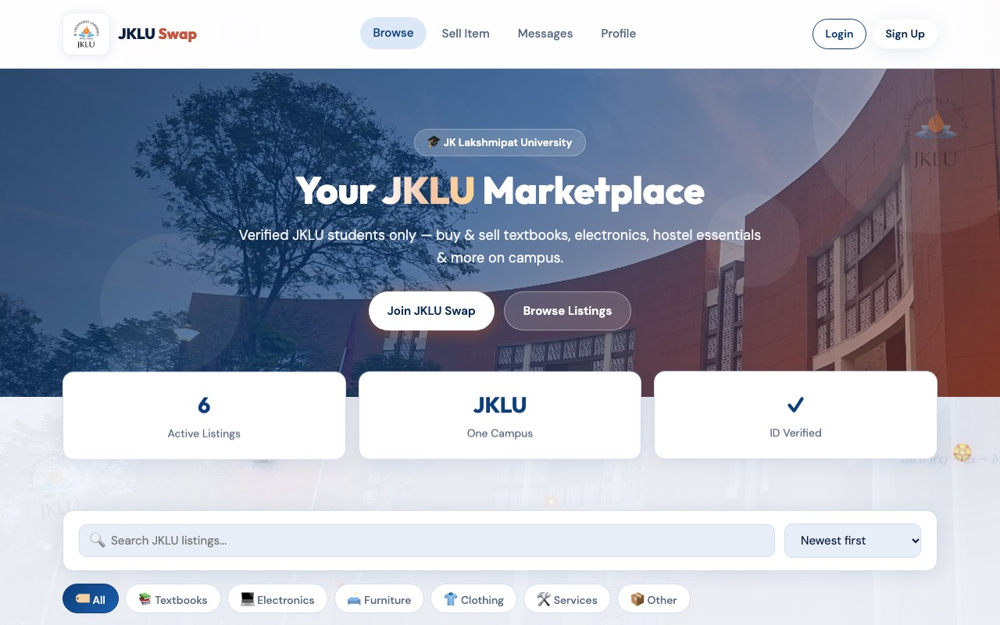
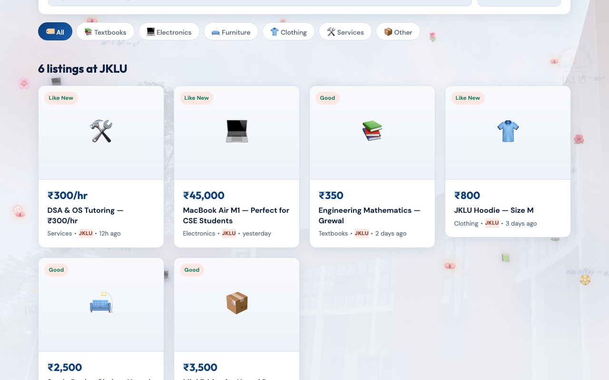
</p>
<p>
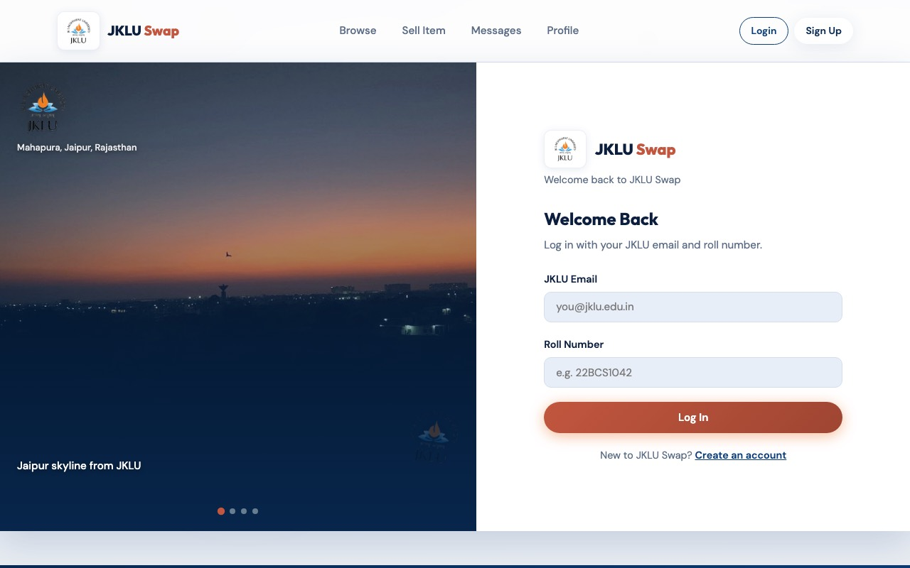
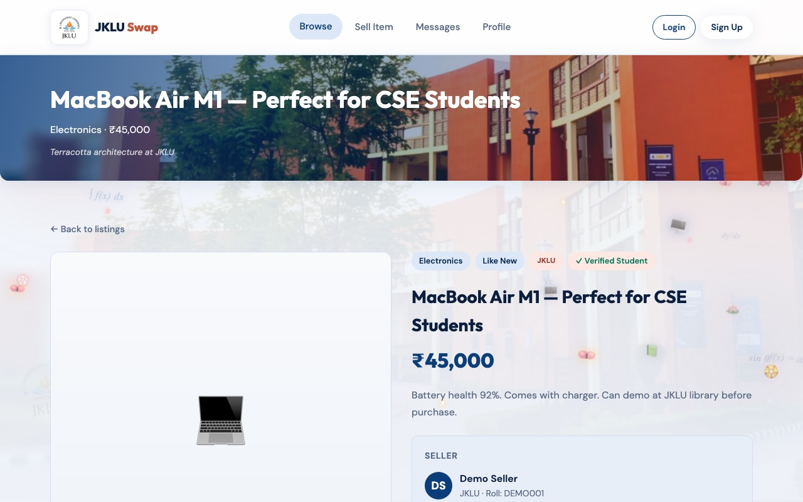
</p>

JKLU Swap had solid bones — listings, college-email sign-up with an ID photo, messaging, a demo checkout. An audit found three kinds of problems:

**Visual noise.** Floating butterflies, flowers, books, laptops and maths equations drifted behind every page. The university logo appeared in both corners, in the header, in the hero and on every slide. "JKLU" appeared **39 times** in the interface code — in the title, hero, stats row, every listing card ("6 listings at JKLU", a "JKLU" tag on each card) and every form label. Each page opened with its own full-width campus photo banner.

**Confusing states.** The experience barely changed once you were logged in — the home page still invited you to *Join JKLU Swap*, and the header was just a bare name and a *Logout* button.

**Security.** This was the serious one:

| Finding | Impact |
|---|---|
| Login was **email + roll number** | Roll numbers are printed on ID cards, attendance sheets and group chats — anyone could log in as a classmate |
| The production API **returned the verification code in its response** | Email verification proved nothing; anyone could verify any address |
| No limit on code guesses | A 6-digit code could be brute-forced |
| Listing input wasn't validated server-side | Arbitrary data could be stored and later rendered |

## 3. Goals

1. **Look professional and calm** — one name, one colour system, no decoration competing with the content.
2. **Make accounts genuinely safe** — nobody should be able to get into someone else's account.
3. **Fit campus life** — solve the problems students actually have, not generic e-commerce ones.
4. **Prove it works** — automated tests for the API, the demo mode and the real browser experience.

## 4. Process — three iterations

### Iteration 1 · The redesign

- **One name.** "JKLU Swap" became **Campus Market**, used consistently everywhere. The university identity moved to where it belongs — the emblem beside the name and the campus photos — instead of being repeated in every sentence.
- **One design system.** A single type family (Inter), a restrained palette, consistent radii, line icons instead of emoji, proper empty states.
- **Less, but better.** The floating decorations and per-page photo banners were removed. Campus photography was concentrated into one strong hero slideshow behind a frosted-glass card.
- **The header knows who you are.** Once you're logged in, *Log in / Sign up* are replaced by *Sell an item* and an account menu.

### Iteration 2 · Identity and trust

- **University colours.** The interface moved from generic indigo to **JKLU orange**, taken from the flame in the emblem.
- **Opening moment.** The emblem was cut out of the full logo, given a transparent background, and animated to **bloom open like a flower** on first visit — a nod to the lotus in the crest. It plays once per tab, is skippable, and never plays for reduced-motion users.
- **Dark mode with an "ink bleed".** Inspired by Codemure's [Ink Bleed](https://github.com/codemure-official/ink-bleed-theme-changer) (WebGL + html2canvas + GSAP), re-implemented in **zero dependencies** with the browser's View Transitions API and an SVG turbulence mask — the new theme spreads like ink from the click point.
- **Passwords.** Login moved to email + password, hashed with PBKDF2-SHA256, with a strength meter, show/hide toggle and a forgot-password flow.

#### What we tried and threw away

Good design is also about what you *don't* ship:

- **A walking stick-figure mascot** in the page background — fun in theory, distracting in practice. Removed.
- **A heavy paper texture** (grain + fibres) for a "premium" feel — it read as dirty rather than premium. It was rolled back the same day and replaced with a **cream background and a barely-visible grain**.

Each rejected idea was reverted cleanly in version control, so experimenting stayed cheap.

### Iteration 3 · Features built for campus

| Feature | The campus problem it solves |
|---|---|
| **Wanted board** | Students often need something specific ("a cycle for one semester"). Sellers can reply with *I have this*, which opens a pre-filled listing. |
| **Course-code search** | Juniors look for "the book for CS201", not a title. `cs 201`, `CS-201` and `CS201` all match. |
| **Safe meetup spots** | Sellers choose a public place — library, canteen, main gate — instead of a hostel room. |
| **Moving-out sale** | Seniors leave with a room full of stuff. List up to 15 items in one form, tagged and filterable. |
| **Unread badge** | Deals die when replies go unseen. A badge in the header *and* the browser tab title. |
| **Seller ratings** | Only someone who chatted with or bought from a seller can rate them, once per listing — so ratings can't be farmed. |
| **Reports** | Three reports from different students hide a listing automatically, without waiting for a moderator. |
| **Saved items, 4 photos, Negotiable tag** | Small things that make browsing and deciding easier. |

<p>
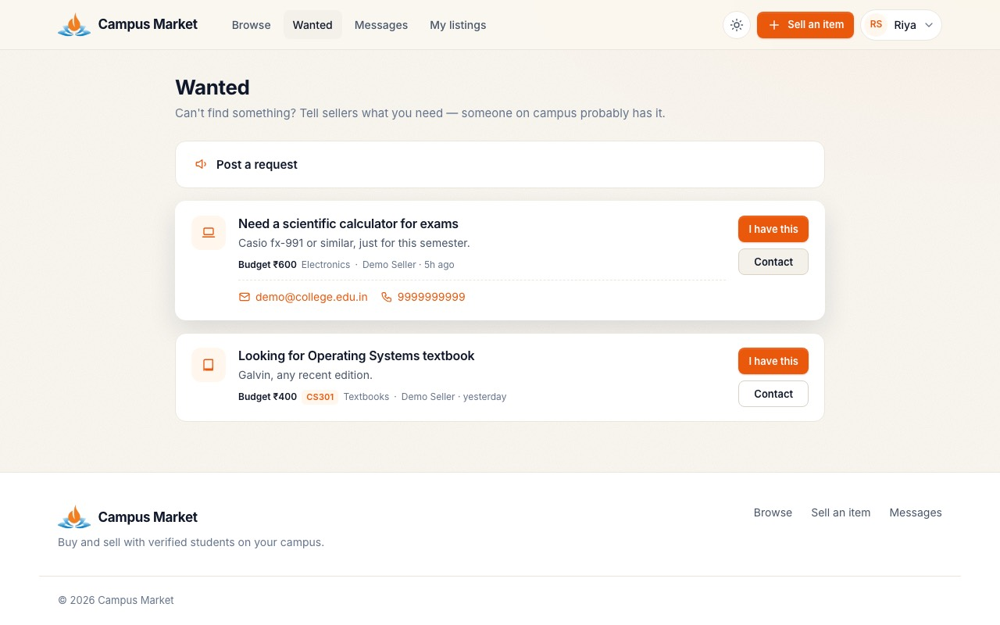
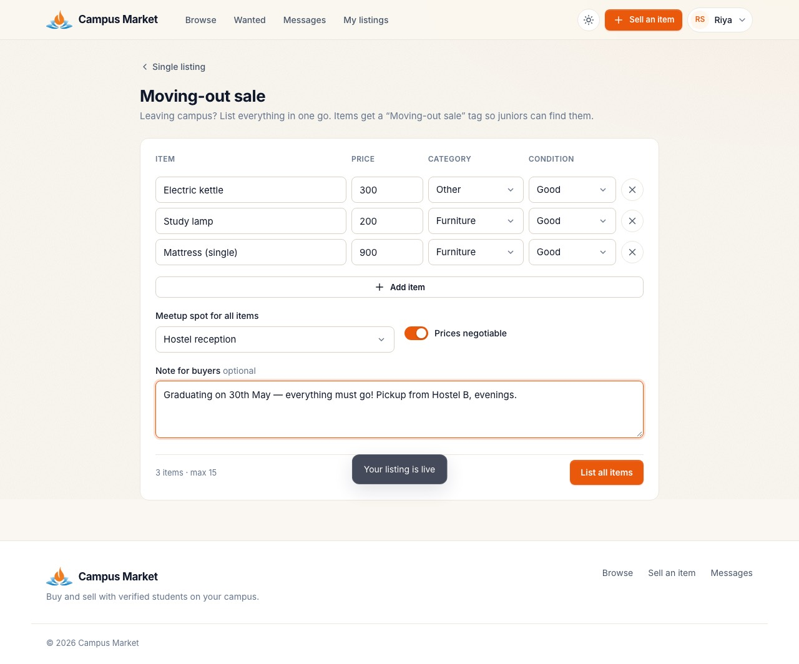
</p>

## 5. Security, end to end

| Threat | Before | After |
|---|---|---|
| Logging in as someone else | Email + roll number | Password, PBKDF2-SHA256, 100k iterations, random salt, constant-time compare |
| Faking email verification | Code returned by the API | Code only **emailed** (Resend); the API refuses auth flows if email isn't configured rather than leak codes |
| Guessing a code | Unlimited attempts | 5 wrong attempts burn the code · 1 resend per minute · 10-minute expiry · crypto-random codes |
| Stale sessions after a reset | — | Resetting a password signs out every device |
| Bad data | No server-side checks | Every listing field validated: lengths, price range, category, ≤ 4 photos and size, course-code format |
| Scams | — | Verified-only accounts, interaction-gated ratings, auto-hide after reports |

### The bug we found by testing like a user

The final round added an automated **browser test** that signs up, sells, chats, rates, reports, switches themes and checks mobile — 20 real user journeys.

While writing the security docs, a closer look at the HTML escaping showed it didn't escape **quote characters**. Listing titles are placed inside attributes such as `alt="…"`, so a title like:

```
x" onload="stealCookies()
```

would break out of the attribute and run code for **every student who scrolled past the listing**.

Rather than assume, we proved it: a test creates exactly that listing and checks whether the script ran.

| Code | Result |
|---|---|
| Old escaping | ❌ `script ran: 1` |
| New escaping | ✅ blocked |

The fix escapes all five HTML-sensitive characters and whitelists image sources (uploaded photos and `https` only). The test now runs on every change, so the hole can't quietly come back.

## 6. Engineering decisions

- **No build step.** Plain ES modules, served as files. Any static host works, there's nothing to configure, and the project stays approachable for other students to contribute to.
- **One API, two implementations.** `js/local-api.js` mirrors the real Cloudflare API — same routes, rules and error messages. The site works fully offline in demo mode, which made design iteration fast and makes the project easy to try.
- **Edge backend.** Hono on Cloudflare Workers with D1: no cold starts and a generous free tier, which matters for a student project.
- **Lightweight lists.** Listing feeds carry only the cover photo; full galleries load on the listing page.
- **Accessible motion.** Every animation — splash, page transitions, scroll reveals, ink bleed — respects `prefers-reduced-motion`.
- **Safe migrations.** Database changes ship as numbered migration files alongside the full schema.

## 7. Results

<p>

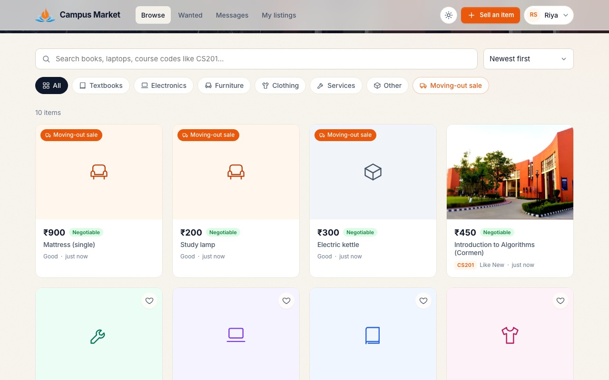
</p>
<p align="center"><em>Before → after: the same listings, without the noise.</em></p>

| | JKLU Swap | Campus Market v2 |
|---|---|---|
| API endpoints | 19 | **31** |
| Database tables | 7 | **12** |
| Automated checks | 0 | **72** (API 31 · demo backend 21 · browser 20) |
| Login | Email + roll number | **Email + hashed password** |
| Verification codes | Returned by the API | **Emailed only** |
| "JKLU" in interface text | 39 mentions | Brand in the emblem and photos only |
| Dark mode | — | ✅ with ink-bleed transition |
| Campus-specific features | — | Wanted board, course codes, meetup spots, moving-out sale, ratings, reports |
| Documentation | README | Feature tour, API reference, deployment guide, architecture, this case study |

<p>
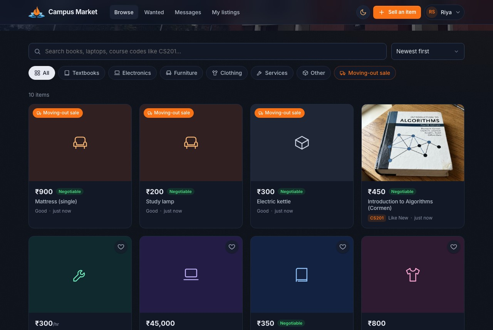
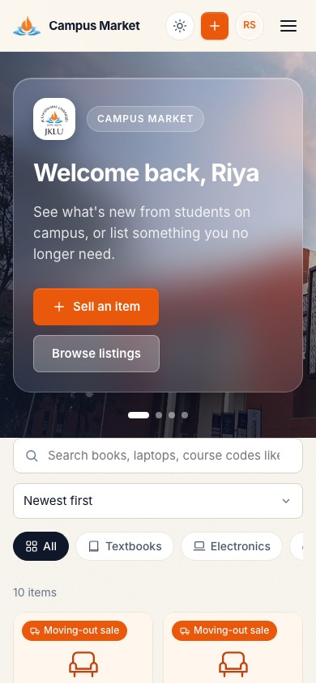
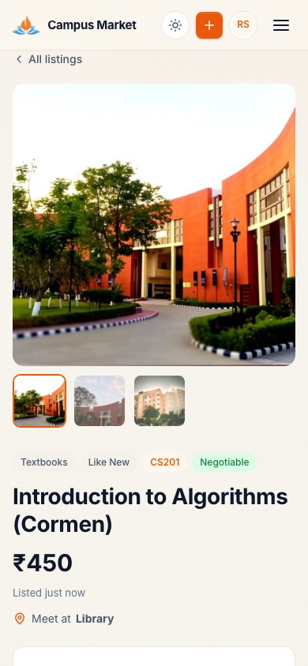
</p>

## 8. What's next

- **Go live** — verify a sending domain in Resend, apply the database migrations and move the existing live site over in one step so old and new versions never run against the same API.
- **Rate-limit logins** at the Cloudflare edge.
- **Session expiry** and "log out of all devices" in settings.
- **Move photos to R2** object storage once listings grow.
- **A moderation view** for reported listings.

## 9. Lessons

1. **Trust is a design problem and an engineering problem.** A polished UI on top of a roll-number login is worse than an ugly one — it makes people trust something they shouldn't.
2. **Fewer, better things.** Removing the decorations did more for the "professional" feel than anything added.
3. **Ship experiments, keep the undo button.** The mascot and the paper texture were tried and reverted within the same session. Version control made "let's see how it feels" cheap.
4. **Test like a user, then test like an attacker.** The worst bug wasn't found by reading code — it was found by trying to break the real thing in a real browser, then proving the fix with the same test.

---

<p align="center">
<a href="../README.md">← Back to the README</a> · <a href="FEATURES.md">Feature tour</a> · <a href="ARCHITECTURE.md">Architecture</a>
</p>
