# Feature tour

A walk through Campus Market, screen by screen — what each part does and why it exists.

---

## 1. First impression

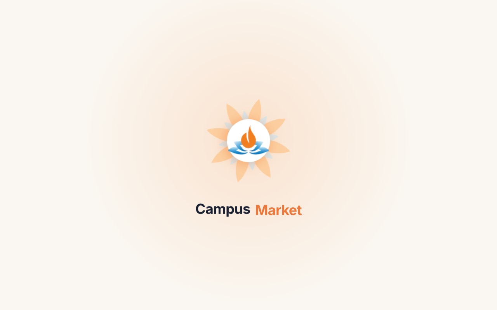

The first time you open the site in a tab, the university emblem **blooms open like a flower**: orange and blue petals unfold, the emblem rises into the centre, and the name fades in. It plays once per tab, you can click to skip it, and it never plays for people who have "reduce motion" turned on.

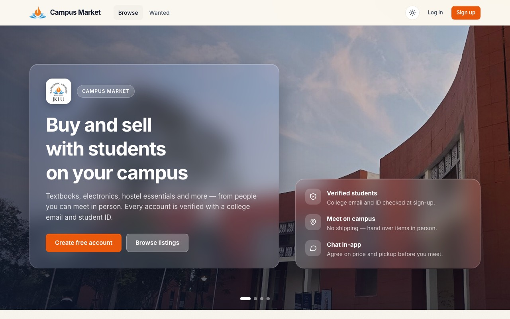

The home page opens on a slow cross-fading slideshow of the campus, with a frosted-glass card on top. Logged-out visitors see what the site is and why it's safe; logged-in students get a "Welcome back" card with a shortcut to sell something.

## 2. Creating an account

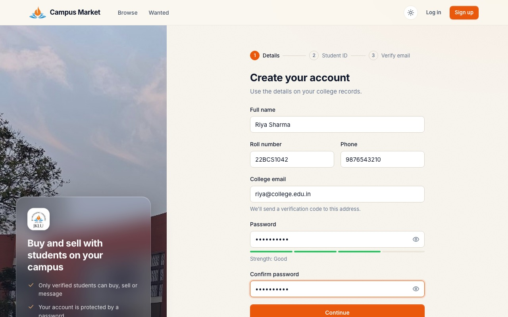

Sign-up has three short steps:

1. **Details** — name, roll number, phone, college email and a **password** (with a live strength meter and show/hide toggle).
2. **Student ID** — take a photo with the camera or upload one.
3. **Verify email** — enter the 6-digit code sent to the college email.

Security details that matter:

- Passwords are hashed with **PBKDF2-SHA256** (100,000 iterations, random salt) — never stored in plain text.
- Codes expire after 10 minutes, can be re-sent once a minute, and **5 wrong guesses burn the code**, so it can't be brute-forced.
- **Forgot password?** uses the same emailed code, and signs you out everywhere else once you reset.
- Once you're logged in, the Log in / Sign up buttons disappear — you get an account menu instead.

## 3. Browsing

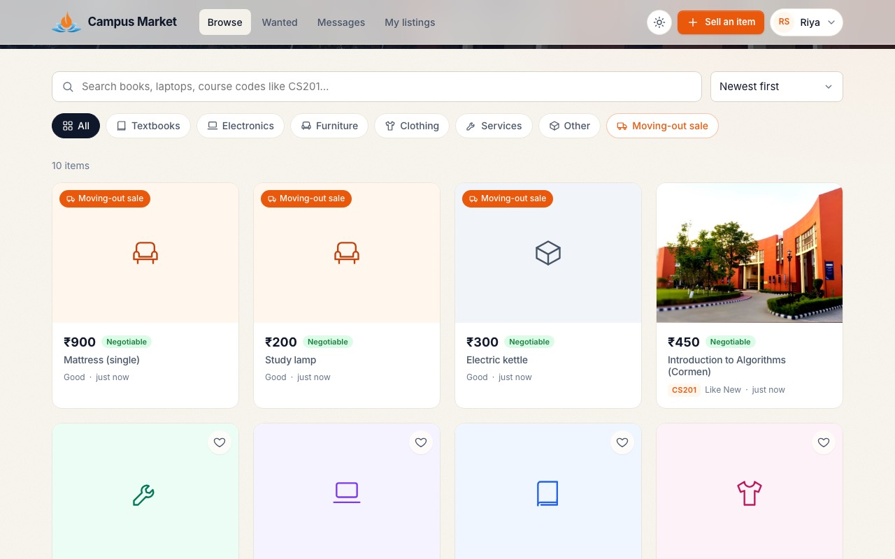

- **Search** matches titles, descriptions, seller names and **course codes** — `cs 201`, `CS-201` and `CS201` all find the same book.
- **Category chips**, plus a dedicated **Moving-out sale** chip.
- **Sort** by newest or price.
- **♥ Save** any listing to come back later (it's in your account menu under *Saved items*).
- Listings without a photo get a tinted, category-coloured placeholder instead of a broken image.

## 4. A listing

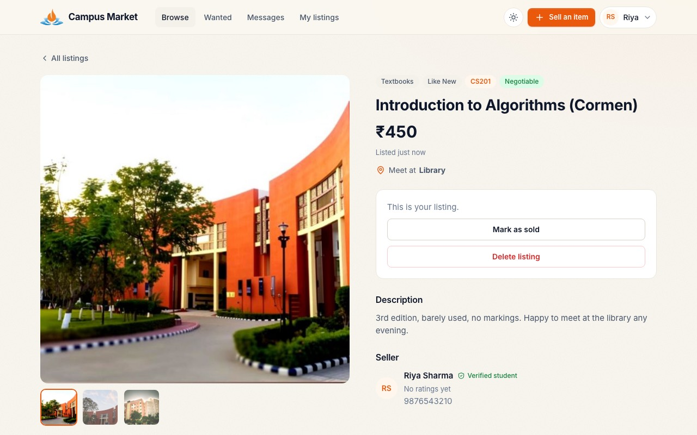

Each listing shows up to **four photos** with thumbnails, tags (category, condition, course code, *Negotiable*, *Moving-out sale*), the **meetup spot** the seller prefers, and the seller's **rating**.

Buyers see **Buy now**, **Message seller** and **Save**. Sellers see **Mark as sold** and **Delete**. Visitors who aren't logged in are asked to log in — only verified students can contact sellers or see phone numbers.

## 5. Selling

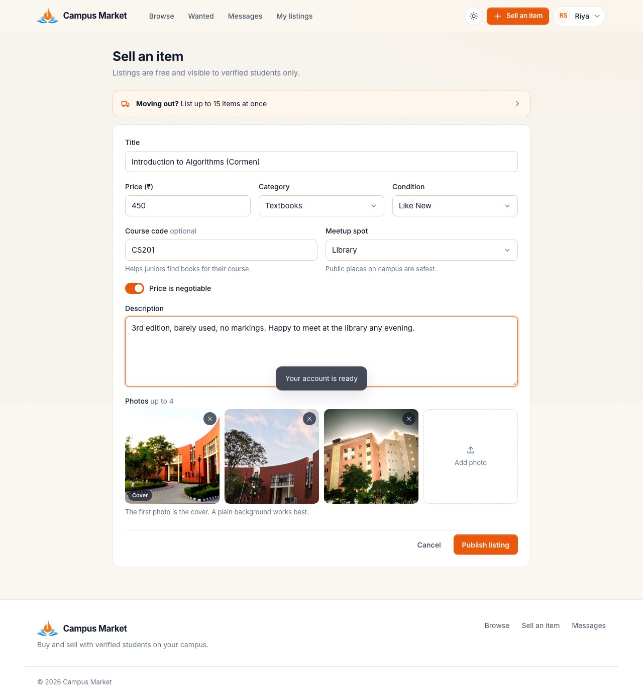

- Up to **4 photos** — the first is the cover; each is resized and compressed in the browser before upload.
- **Course code** (optional) so juniors can search for exactly the book their course needs.
- **Meetup spot** from a list of public places on campus (library, canteen, main gate…).
- **Negotiable** switch.

### Moving-out sale

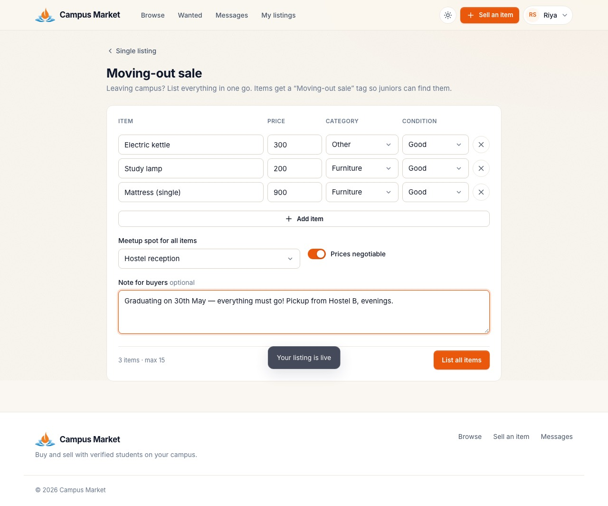

Graduating seniors can list **up to 15 items in one go** — just a name and price per row, with one shared meetup spot and note. All of them get the *Moving-out sale* tag.

## 6. The Wanted board

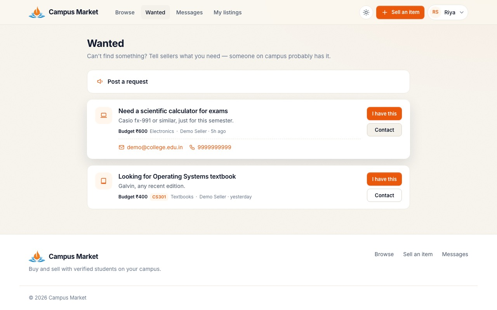

Can't find something? Post a request with an optional budget and course code.

- **I have this** opens the sell form already filled in with the item, category and course code.
- **Contact** reveals the requester's email and phone — only to verified students.
- Remove your request once you've found it (max 10 open requests per person).

## 7. Messages

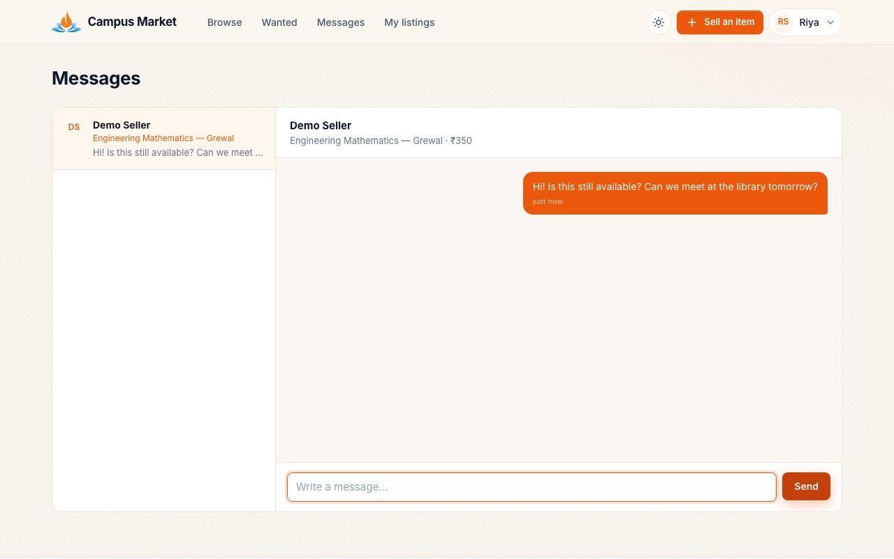

Every listing has its own conversation between buyer and seller. New messages show:

- a **red badge** on *Messages* in the header,
- a count in the **browser tab title** — e.g. `(2) Campus Market`,
- a count next to each conversation.

Opening a conversation marks it as read. The badge refreshes every 30 seconds while the tab is visible.

## 8. Trust & safety

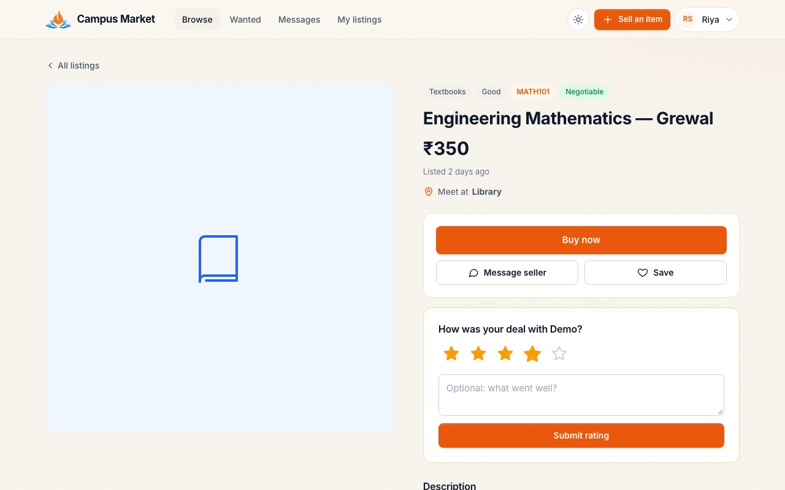

**Ratings** — after you've chatted with or bought from a seller, a *How was your deal?* card appears on the listing. You can rate each listing once, and sellers can't rate themselves. Ratings show on listings and on the seller's profile.

**Reports** — any verified student can report a listing (spam, scam, not allowed on campus, wrong details). Reports are anonymous; after **three** different students report a listing it's **hidden automatically**, and the seller is told why.

## 9. Your profile

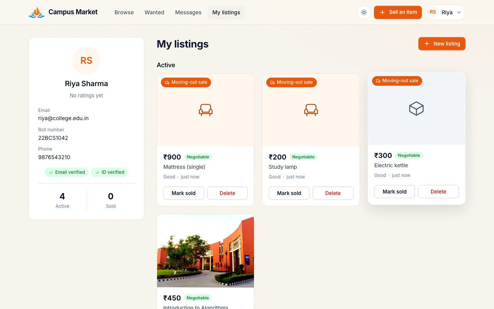

Your details, verification badges, rating, active/sold counts, all your listings (with quick *Mark sold* / *Delete* buttons) and the reviews other students left you.

## 10. Dark mode

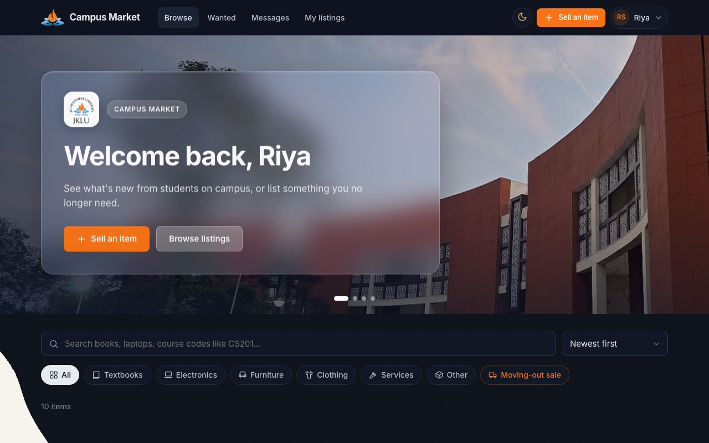

Click the moon in the header and the dark theme **bleeds across the page like ink** from where you clicked. Your choice is remembered, and the site follows your system setting the first time you visit.

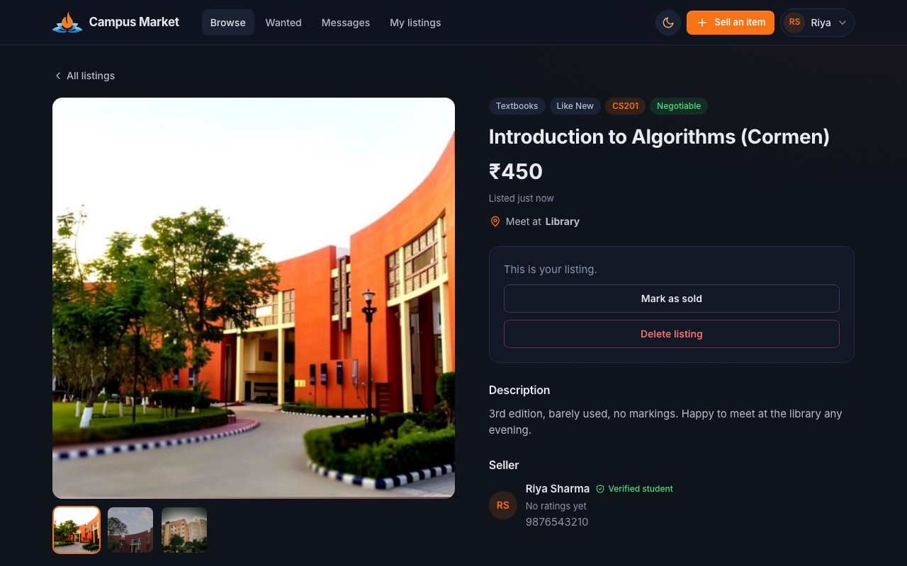

## 11. On your phone

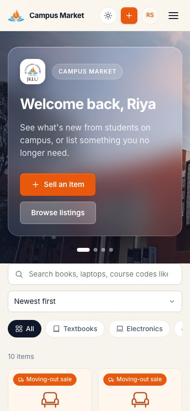
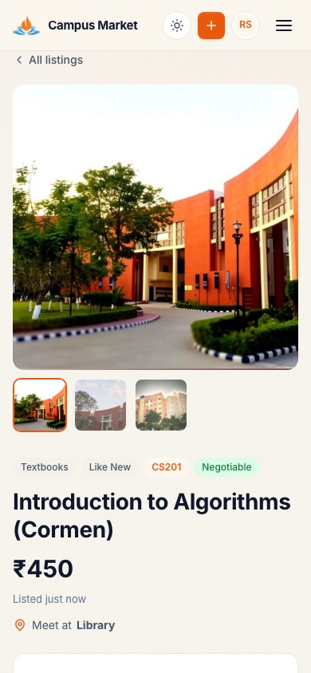

Everything works one-handed on a phone: the nav collapses into a menu, the *Sell* button becomes a compact **+**, and chat switches between the conversation list and the open conversation.
